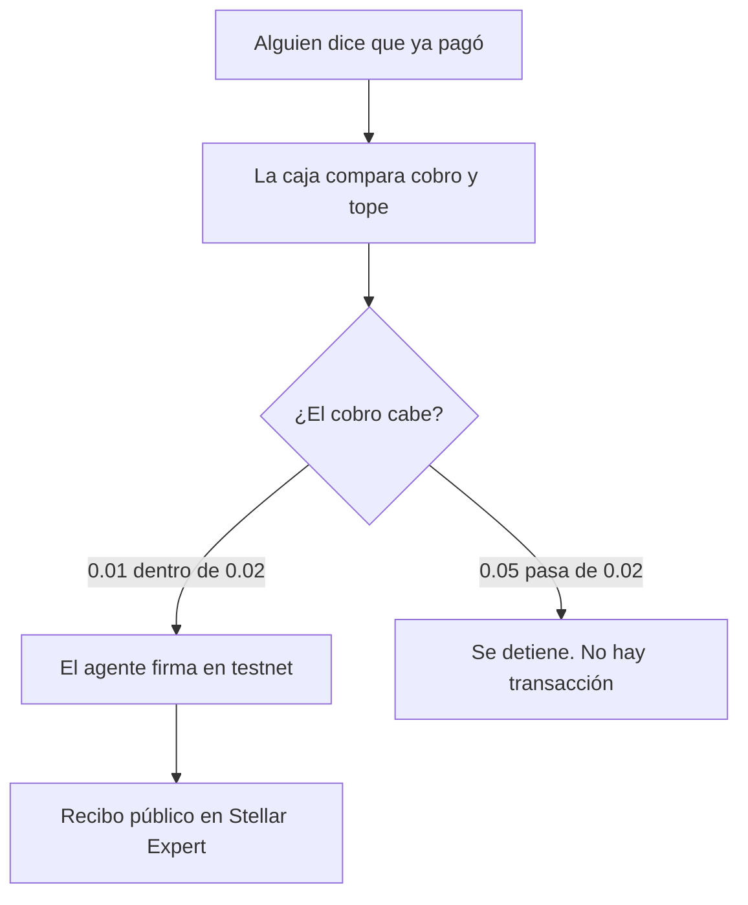

<p align="center">
  
  
  
  
</p>

<h1 align="center">Caja del agente</h1>

<p align="center">
  Un agente con tope que paga y verifica cada cobro en Stellar.<br>
  <b>Agente que paga · Código 402 · BAF México × Embajadores de Stellar</b><br>
  Dinero de práctica. Nada de esto sale de testnet.
</p>

<p align="center">
  <a href="https://caja-del-agente-production.up.railway.app"></a>
  &nbsp;
  <a href="https://caja-del-agente-production.up.railway.app/tienda"></a>
  &nbsp;
  <a href="https://stellarapex.org/projects/d7d4a8f8-8854-4679-8967-9043983d899b"></a>
</p>

---

## La decisión, en un dibujo

El negocio quiere cobrar. El agente del cliente solo firma si el cobro cabe en el tope.



| Cobro | Tope | Qué hace el agente |
| :---: | :---: | :--- |
| `0.01` | `0.02` | Cabe. Puede firmar. |
| `0.05` | `0.02` | No cabe. No firma nada. |

## Dos formas de verlo

<table>
  <tr>
    <td width="50%" valign="top">
      <h3 align="center">Caja fija</h3>
      <p align="center">El cobro ya está escrito: <b>0.01</b><br>El tope ya está escrito: <b>0.02</b></p>
      <p>Confirmar dice si ese cobro cabe. Probar 0.05 se detiene y no firma nada. Sirve para el minuto en que el jurado solo tiene que ver el sí y el no.</p>
      <p align="center"><a href="https://caja-del-agente-production.up.railway.app"><b>Abrir la caja →</b></a></p>
    </td>
    <td width="50%" valign="top">
      <h3 align="center">Tiendita</h3>
      <p align="center">El tendero escribe el cobro.<br>El cliente escribe el tope.</p>
      <p>Si el cobro cabe, Enviar escribe ese monto en la red, de la cartera del cliente a la del tendero, y deja el recibo. Las dos cantidades se cambian en la página.</p>
      <p align="center"><a href="https://caja-del-agente-production.up.railway.app/tienda"><b>Abrir la tiendita →</b></a></p>
    </td>
  </tr>
</table>

La app está publicada en Railway. El servidor arranca con `npm start`.

## Demo Day · viernes 27 · 18:00 a 20:00

Track: **Agente que paga (x402)**. Tres minutos.

| Minuto | Paso | Qué se muestra |
| :--- | :--- | :--- |
| `0:00` | El problema | Alguien dice que ya pagó y el negocio suelta el producto sin saber si el dinero llegó. |
| `0:30` | Confirmar 0.01 | El agente puede pagar: 0.01 cabe en el tope de 0.02 USDC. |
| `1:15` | Probar 0.05 | No se firma nada, porque pasa el tope. |
| `2:00` | La evidencia | El recibo del pago que sí se firmó, abierto en Stellar Expert. |
| `2:30` | Qué sigue | Un pago en pesos con CoDi dispara este mismo agente. |

<p align="center">
  <a href="https://stellar.expert/explorer/testnet/tx/af936bedf8aba96c4de5bc13a9ad9655fd9615d20019a9d8bda10aeaa8702ef4"></a>
</p>

## Cómo correrlo

Cada integrante explica su parte en `partes/<usuario>/README.md`.

```bash
node partes/MetaNetMx/caja.js
```

Ese comando solo decide. No firma. Imprime si 0.01 cabe en el tope de 0.02.

## Equipo

| Quién | Parte |
| :--- | :--- |
| [MetaNetMx](https://github.com/MetaNetMx) | [Tope, pruebas y recibo](partes/MetaNetMx/README.md) |

## Recibos en testnet

Cada fila es un pago que ya está en la red de práctica. El enlace abre el hash completo.

| Sesión | Qué quedó | Hash | Recibo |
| :--- | :--- | :--- | :---: |
| 1 | Primer pago en Stellar | `2c1f966b9b69f85e37b30ed1cdd1680b85330409b8c4ec0cf6ad3614632a886d` | [ver](https://stellar.expert/explorer/testnet/tx/2c1f966b9b69f85e37b30ed1cdd1680b85330409b8c4ec0cf6ad3614632a886d) |
| 2 | La API cobra con x402 | `d4581335aa334373bdd6df9244e000f1face1ef3d36fce607ceb324da4572c07` | [ver](https://stellar.expert/explorer/testnet/tx/d4581335aa334373bdd6df9244e000f1face1ef3d36fce607ceb324da4572c07) |
| 3 | El agente paga solo, con tope de $0.02 | `af936bedf8aba96c4de5bc13a9ad9655fd9615d20019a9d8bda10aeaa8702ef4` | [ver](https://stellar.expert/explorer/testnet/tx/af936bedf8aba96c4de5bc13a9ad9655fd9615d20019a9d8bda10aeaa8702ef4) |
| 4 | El verificador consulta ese pago por RPC | `61f3ea35bf0e3af8d07329a038eeb4f9095b52eb1437817942b5f59751733699` | [ver](https://stellar.expert/explorer/testnet/tx/61f3ea35bf0e3af8d07329a038eeb4f9095b52eb1437817942b5f59751733699) |
